# Emerging Travel Group: a daily commercial & pricing cockpit

Public market data, a real hotel-booking dataset and a simulated sales ledger, turned into daily monitoring,
root-cause analysis and a price-match decision process for a multi-brand B2B travel platform.

**Report (PDF, 11 pages):** [docs/ETG_CommercialPricing_CaseStudy.pdf](docs/ETG_CommercialPricing_CaseStudy.pdf)  ·
**Excel dashboard (view online):** [excel/](excel/README.md)  ·
**Excel workbook as PDF:** [excel/ETG_Commercial_Pricing_Cockpit.pdf](excel/ETG_Commercial_Pricing_Cockpit.pdf)  ·
**Excel file:** [excel/ETG_Commercial_Pricing_Cockpit.xlsx](excel/ETG_Commercial_Pricing_Cockpit.xlsx)

> Independent case study based on public data · not affiliated with or endorsed by Emerging Travel Group.
> Labels used everywhere: **PUBLIC DATA** (real, sourced), **REAL DATASET** (open hotel bookings, two hotels in
> Portugal 2015-2017, not ETG data), **SIMULATED** (generated, seed 42, not ETG data).

## Key results

1. **B2B behaves differently** (REAL DATASET, 119,390 bookings): travel agents and tour operators bring 82% of bookings,
   pay a lower nightly rate (€102 vs €120 direct), book 4× earlier and cancel 2.3× more often (41% vs 17.5%).
   Ten agents make 72% of agent revenue.
2. **A real revenue drop explained** (REAL DATASET): September 2016 revenue fell €519k vs August, but room nights
   barely moved (volume −€93k); cheaper group business (mix −€219k) and end-of-summer rates (price −€207k) did the rest.
3. **Six events traced to their cause** (SIMULATED): the daily alert band catches the supplier margin drop, a market
   holiday and a cancellation spike on day one; a lost API partner needs the weekly drill-down; the costliest event,
   lira price lists lagging the real ECB rate (−€122k of margin), only shows in the monthly volume / mix / price / FX /
   cost bridge.
4. **Price matches decided by rules** (SIMULATED): 58% of 1,347 claims survive a like-for-like check (taxes, breakfast,
   cancellation policy); 21% get a discount, 11% a cheaper supplier, 51% a reasoned refusal within a 4% margin floor:
   €2.7k of discounts kept €134k of sales.

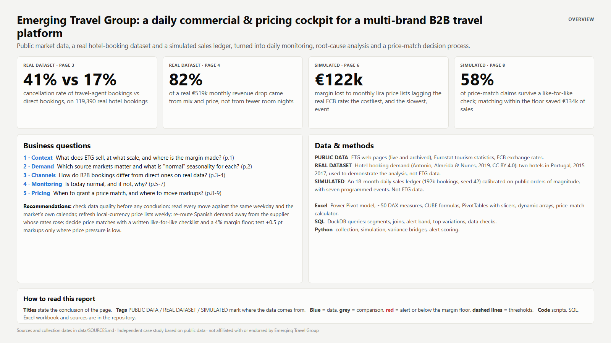

## Questions and answers

| # | Question | Data | Answer |
|---|---|---|---|
| 1 | What does ETG sell, at what scale, where is the margin made? | PUBLIC DATA (emergingtravel.com live + 6 archived versions) | Three brands (RateHawk B2B, ZenHotels B2C, Roundtrip corporate) on one inventory: 350+ suppliers, 110K+ agents, 1,400+ API partners, 130K+ bookings a week. Margin = selling price − supplier net rate; direct hotel contracts ×7.1 since 2021. |
| 2 | Which source markets matter, and what is "normal" seasonality? | PUBLIC DATA (Eurostat) | Germany, France, Italy and Spain lead EU hotel nights. Italians take 34% of their nights abroad on trips starting in August; Germans spread theirs over seven months. |
| 3 | How do B2B bookings differ from direct ones? | REAL DATASET | Lower rate, longer lead time, 2.3× the cancellation rate, strong concentration on a few agents. A 99% cancellation rate on "non-refundable" bookings is flagged as a coding question, not a finding. |
| 4 | Why did revenue fall in September 2016? | REAL DATASET | Volume / mix / price bridge + top-down drill: the resort hotel explains 93% of the drop; group business at ~€70 a night replaced online-agency guests. |
| 5 | Is today normal, and if not, why? | SIMULATED | Three layers: daily statistical band, weekly partner drill-down, monthly variance bridge. Data-quality checks run first (duplicates, missing costs, time-zone shift). |
| 6 | When to grant a price match, and where to move markups? | SIMULATED | Written checklist + margin floor; reply templates; +0.5 / −0.5 pt markup moves only where price-match pressure and growth support it, effect shown as a range. |

## The Excel workbook, sheet by sheet

`excel/ETG_Commercial_Pricing_Cockpit.xlsx` (Excel 365 for Windows; built by `src/build_excel.py` through COM automation).
No need to download it: the [Excel dashboard page](excel/README.md) shows every sheet, and the
[PDF view](excel/ETG_Commercial_Pricing_Cockpit.pdf) prints the workbook.

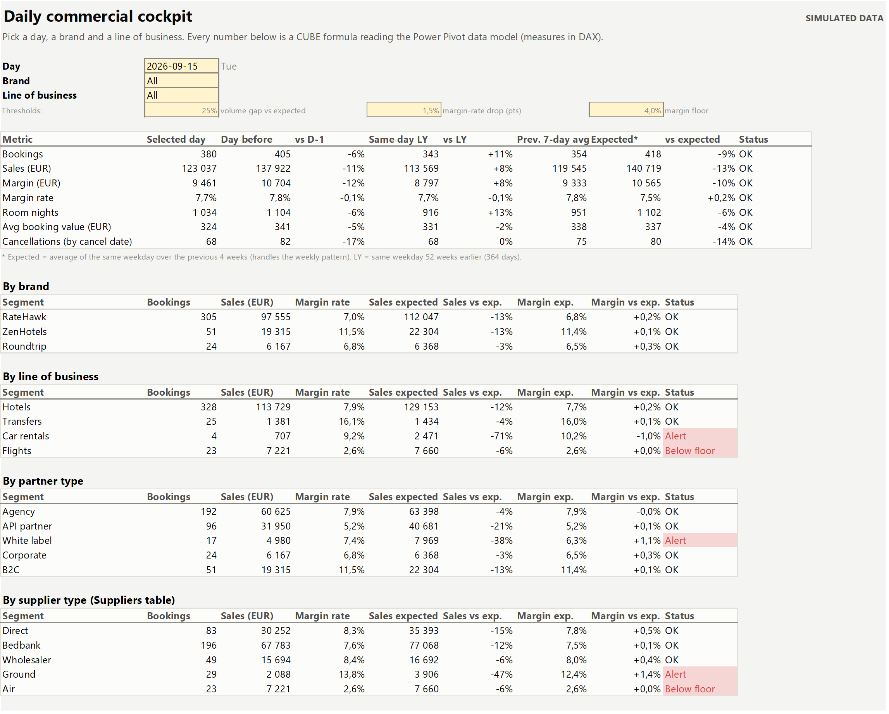

| Sheet | What it shows | Excel features |
|---|---|---|
| README | What each sheet does, definitions, what is real and what is simulated | |
| Cockpit | Day / brand / line-of-business selectors; KPIs vs day before, same day last year, 7-day average and expected value; tables by brand, line of business, partner type, supplier type, source market, destination; top 10 partners; 28-day trend | **Power Pivot data model**, ~50 **DAX measures**, `CUBEMEMBER`, `CUBEVALUE`, `CUBESET` (MDX `TOPCOUNT`), `CUBERANKEDMEMBER`, `XLOOKUP`, conditional formatting |
| Pivots | Sales and margin by month and brand; supplier margin by month; real ECB rates | **PivotTables on the data model**, 6 **slicers** shared by two PivotTables |
| Alerts | Pick a dimension, a member and a metric: daily value, expected value, noise, z-score, alert band, list of alert days | `LET`, `SUMIFS` on a dynamic column (`INDEX`/`MATCH`), `STDEV.S`, `FILTER`, `SORT`/`UNIQUE`/`CHOOSECOLS` (drop-down list), line chart with dashed band |
| Bridge | Margin change between any two months split into volume, mix, price, FX and cost (check cell = 0) | dynamic arrays on spilled ranges (`B32#`), `SUMIFS` with array criteria, `SUMPRODUCT`, waterfall chart |
| PriceMatch_Calc | One request: evidence, like-for-like adjustments, floor price, maximum discount, decision, reply text | `IF`/`AND`/`SWITCH`, `FIXED`, drop-downs |
| PriceMatch_Log | 1,347 requests with KPIs; a `LET` formula re-applies the rules to every row ("rule check") | structured references, `COUNTIFS`, `SUMIFS`, `AVERAGEIFS`, `SUMPRODUCT`, `MEDIAN` |
| Pricing | Markup moves by B2B segment and expected margin effect for an elasticity range you can change | table formulas, `LET` |
| Data_Quality | Issues found in the raw ledger and their effect on daily totals | flags + conditional formatting |
| Partners_Suppliers, Data_Daily, Data_Monthly, Lists | Dimension and aggregated tables used by the formulas; drop-down values | Excel tables |

Data model: `Bookings` (clean ledger, 192,489 rows) → `Calendar` (date), `Suppliers`, `Partners`, `FX` (date|currency key).
Measures include `[Sales EUR]`, `[Margin EUR]`, `[Margin %]`, `[Cancellations]` (counted on the cancellation date with
`TREATAS`), and for each one `D-1`, `LY` (−364 days), `7d Avg` and `Expected` (same weekday, previous 4 weeks).

## SQL queries

DuckDB, run with `python src/run_sql.py` (results in `data/output/sql/`). Details: [sql/README.md](sql/README.md).

| File | Question |
|---|---|
| `01_daily_sales_by_segment.sql` | Daily sales, margin and margin rate by brand and line of business |
| `02_margin_by_supplier.sql` | Monthly margin by supplier (JOIN suppliers): spots a supplier rate increase |
| `03_alerts_same_weekday.sql` | Daily alerts by source market (window functions) - same 9 alerts as Python |
| `04_top_partner_variations.sql` | Partners explaining a drop, last 14 days vs the 14 before (JOIN partners) |
| `05_price_match_summary.sql` | Price-match KPIs by partner type and decision |
| `06_data_quality_checks.sql` | Duplicates, missing net costs, time-zone shift - run before anything else |

## Playbook

[playbook/](playbook/): [incident cards](playbook/incident_cards.md) · [price-match checklist and rules](playbook/price_match_rules.md) ·
[reply templates](playbook/response_templates.md) (accept, switch, refuse with arguments, ask for details, escalation) ·
[daily summary format](playbook/daily_summary.md) for the commercial team.

## Report pages

| | |
|---|---|
| 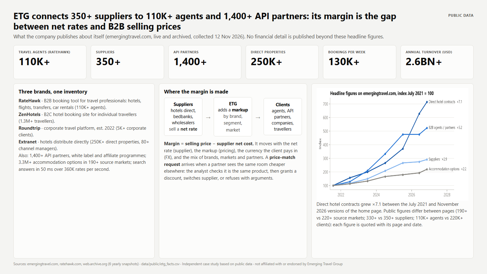 | 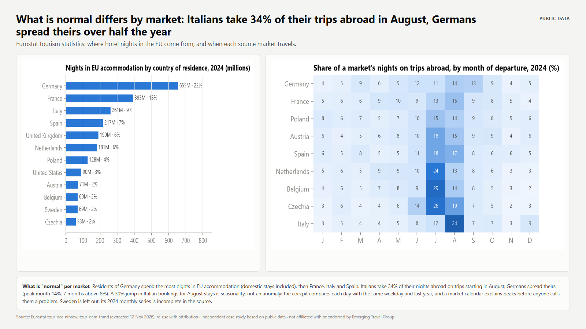 |
| 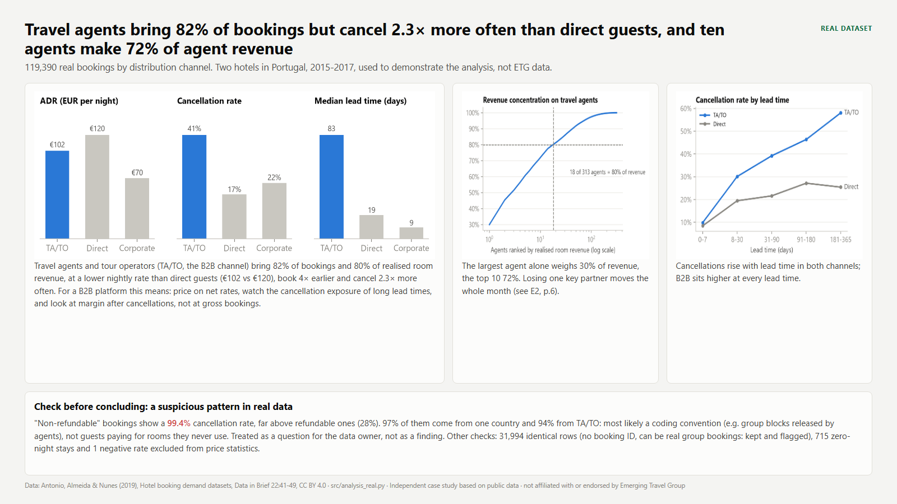 | 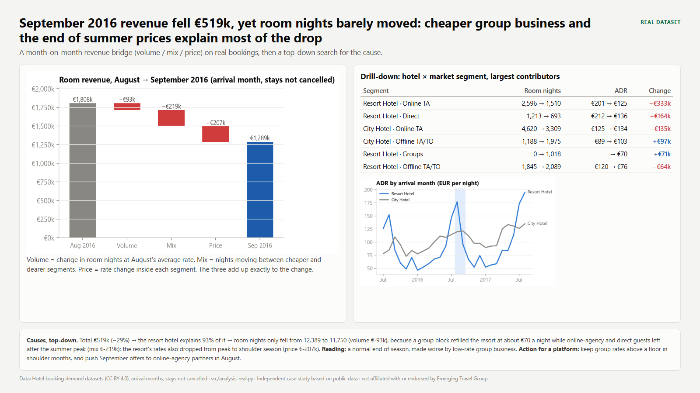 |
| 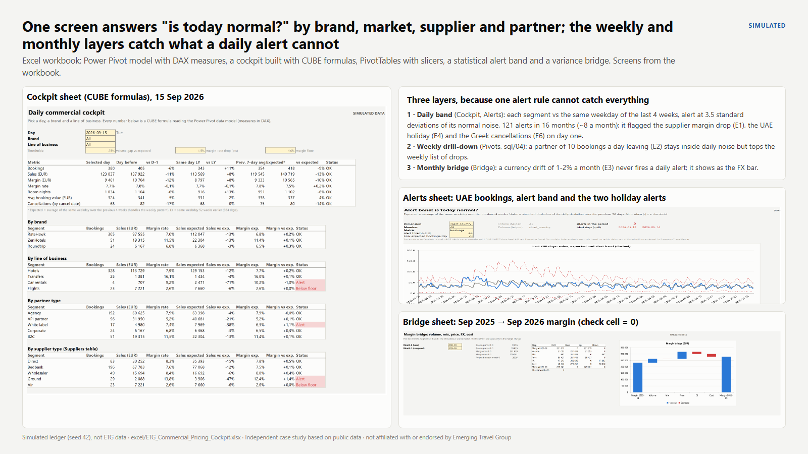 | 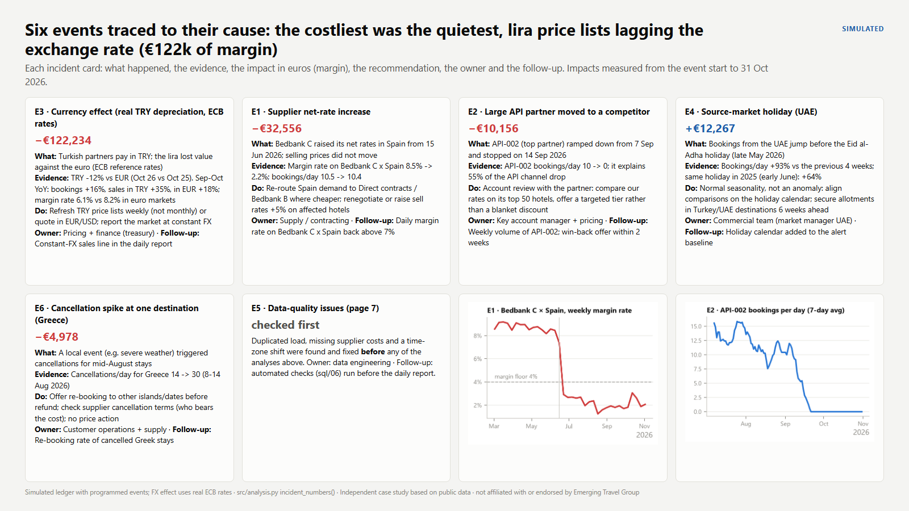 |
| 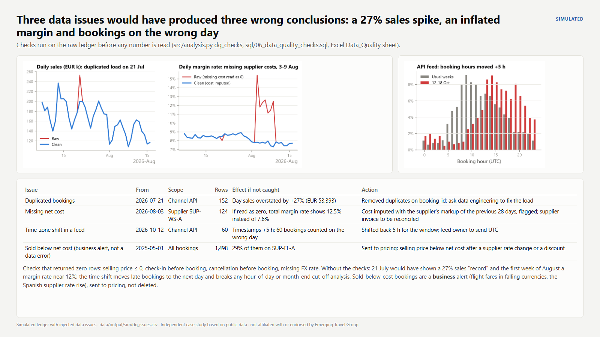 | 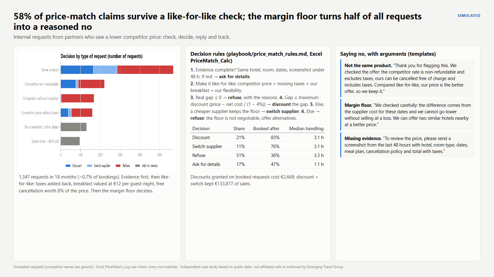 |
| 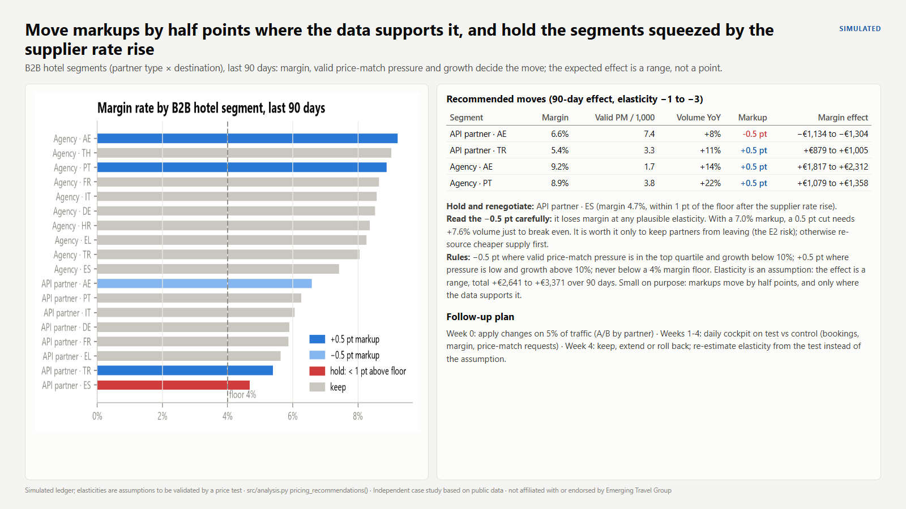 | 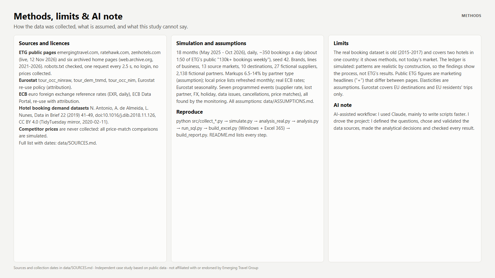 |

## Methods

```
src/collect_etg_site.py    public ETG pages, robots.txt checked, 1 request / 2.5 s      -> data/raw/etg_site (not committed)
src/collect_wayback.py     6 archived home pages (2021-2026)                             -> data/public/etg_headline_history.csv
src/collect_eurostat.py    Eurostat API (3 datasets)                                     -> data/public/eurostat_*.csv
src/collect_ecb_fx.py      ECB daily reference rates                                     -> data/public/ecb_fx_daily.csv
src/analysis_real.py       real bookings: data checks, channels, Pareto, revenue bridge  -> data/output/real/
src/simulate.py            simulated ledger, seed 42, 7 programmed events                -> data/simulated/
src/analysis.py            data quality, daily comparisons, alerts, incidents, margin bridge, price match, pricing -> data/output/sim/
src/run_sql.py             runs sql/*.sql with DuckDB                                    -> data/output/sql/
src/build_excel.py         Excel workbook through COM (Windows + Excel 365)              -> excel/
src/build_playbook.py      incident cards and daily summary from the outputs             -> playbook/
src/build_report.py        charts + HTML + PDF (Edge headless)                           -> docs/
notebooks/                 01 real bookings, 02 daily cockpit, 03 price match (step-by-step, executed)
```

- **Variance bridges.** Revenue (real data) = Σ room nights × ADR, split into volume, mix and price. Margin (simulated)
  = Σ bookings × (price − cost), split into volume, mix, price at constant FX, FX translation and cost. Each bridge adds
  up exactly to the change; the Python, Excel and report figures match.
- **Alert band.** Expected = average of the same weekday over the previous 4 weeks; noise = standard deviation of the
  daily deviation over the previous 56 days; alert when |deviation / noise| ≥ 3.5 for segments expected at 20+
  bookings a day. Identical in Python, SQL and Excel. Scored afterwards against the simulation's answer key.
- **Data quality first.** Duplicated booking IDs, missing supplier costs (imputed with the supplier's recent markup,
  flagged), a feed time-zone shift (found by matching each day's hourly profile to the usual one), and business checks
  (sold below cost).
- **Price-match rules.** Evidence → like-for-like adjustments → real gap → maximum discount at a 4% margin floor →
  discount, switch supplier or refuse. Same rules in Python, the Excel calculator and the playbook.

### Reproduce

```bash
python -m venv .venv
.venv\Scripts\pip install -r requirements.txt
.venv\Scripts\python src\collect_etg_site.py      # optional: public data is already in data/public
.venv\Scripts\python src\simulate.py
.venv\Scripts\python src\analysis_real.py
.venv\Scripts\python src\analysis.py
.venv\Scripts\python src\run_sql.py
.venv\Scripts\python src\build_playbook.py
.venv\Scripts\python src\build_excel.py          # Windows + Excel 365 only
.venv\Scripts\python src\build_report.py         # needs Microsoft Edge or Google Chrome
```

The workbook stores its data: opening it needs no refresh. To reload the CSV files, update the folder path in
Data > Queries & Connections, then Refresh All.

## Sources and licences

Full list with collection dates: [data/SOURCES.md](data/SOURCES.md). Assumptions: [data/ASSUMPTIONS.md](data/ASSUMPTIONS.md).

- Emerging Travel Group public web pages (emergingtravel.com, ratehawk.com, zenhotels.com), collected 12 Nov 2026,
  and Internet Archive snapshots 2021-2026. Raw pages are not redistributed.
- Eurostat tourism statistics (`tour_occ_ninraw`, `tour_dem_tnmd`, `tour_occ_nim`) - Eurostat re-use policy.
- ECB euro foreign exchange reference rates - ECB Data Portal.
- N. Antonio, A. de Almeida, L. Nunes, *Hotel booking demand datasets*, Data in Brief 22 (2019) 41-49,
  doi:10.1016/j.dib.2018.11.126 - CC BY 4.0.
- Competitor prices are never collected: all price-match comparisons are simulated.

## Limits

- The real booking dataset is old (2015-2017) and covers two hotels in one country: it shows the methods, not today's market.
- The ledger is simulated: its patterns are realistic by construction, so the findings show the process, not ETG's results.
- Public ETG figures are marketing headlines ("+") and some differ between pages; each is quoted with its page and date.
- Price elasticities (−1 to −3) are assumptions to be replaced by a price test.
- Eurostat covers EU destinations and EU residents' trips only.

## AI note

AI-assisted workflow: I used Claude, mainly to write scripts faster. I drove the project: I defined the questions, chose and validated the data sources, made the analytical decisions and checked every result.
