# Excel workbook: daily commercial & pricing cockpit

The workbook at a glance, without opening Excel. Every screen below is a picture of the real workbook,
exported by `src/build_excel.py`.

**Files:** [PDF view of the workbook (15 pages)](ETG_Commercial_Pricing_Cockpit.pdf) ·
[Excel file (.xlsx, 16 MB)](ETG_Commercial_Pricing_Cockpit.xlsx) · [Full case study report (PDF)](../docs/ETG_CommercialPricing_CaseStudy.pdf)

> **SIMULATED data** (seed 42), not Emerging Travel Group data. Exchange rates are real ECB reference rates.
> Independent case study, not affiliated with or endorsed by Emerging Travel Group.

| What | How it is built |
|---|---|
| Data model | Power Pivot: Bookings (192,489 rows), Calendar, Suppliers, Partners, FX; 4 relationships; 49 DAX measures |
| Daily cockpit | CUBEMEMBER, CUBEVALUE, CUBESET (MDX TOPCOUNT), CUBERANKEDMEMBER on the data model |
| Exploration | 3 PivotTables on the data model, 6 slicers |
| Alert band | LET, SUMIFS on a dynamic column, STDEV.S, FILTER, SORT / UNIQUE / CHOOSECOLS |
| Variance bridge | Dynamic arrays (UNIQUE, SUMIFS on spilled ranges), waterfall chart; check cell = 0 |
| Price-match | Calculator with like-for-like adjustments and a margin floor; log of 1,347 requests with a LET rule check |
| Checks | Excel, Python and SQL give the same figures (bridge to the cent, same alerts, 1,347 / 1,347 decisions) |

---

## 1. Cockpit: is today normal?

Pick a day, a brand and a line of business (yellow cells). Each KPI is compared with the day before, the same
weekday last year, the previous 7-day average, and an **expected value** (same weekday over the previous 4 weeks).
Status turns red on a volume gap above 25%, a margin-rate drop of 1.5 points, or a margin below the 4% floor.

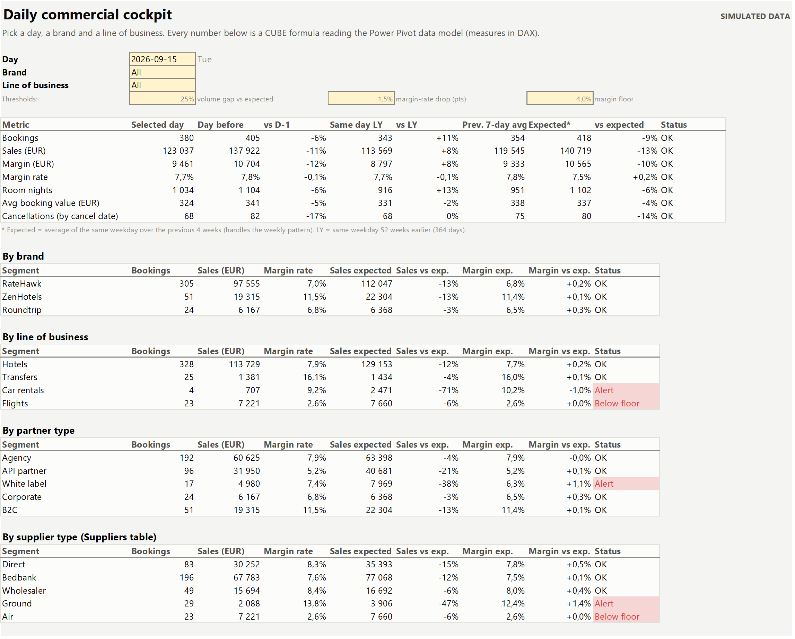

By source market and destination, then the **top 10 partners of the day**, ranked inside the data model with
`CUBESET("ThisWorkbookDataModel", "TOPCOUNT([Bookings].[partner_id].children, 10, ...)")` and `CUBERANKEDMEMBER`:

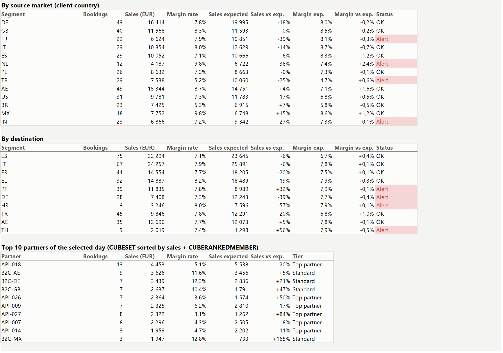

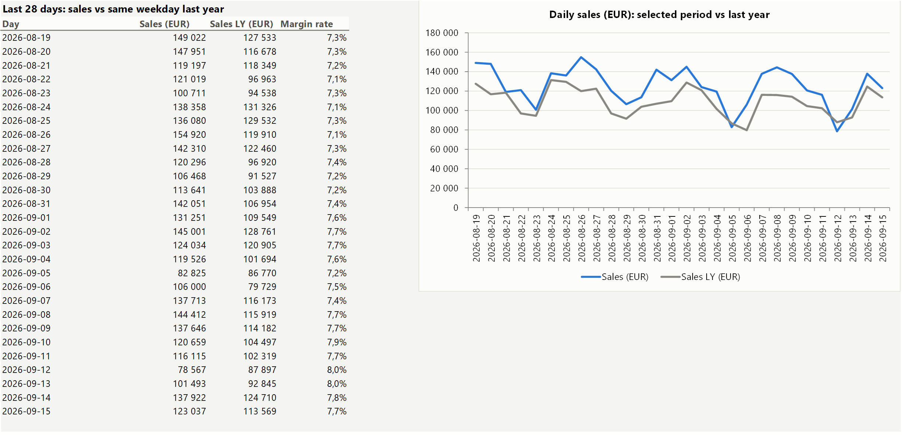

DAX example (sales on the day before, used through `CUBEVALUE`):

```dax
Sales EUR D-1 :=
VAR d = MAX ( 'Calendar'[date] )
RETURN CALCULATE ( [Sales EUR], FILTER ( ALL ( 'Calendar' ), 'Calendar'[date] = d - 1 ) )
```

## 2. PivotTables and slicers

Sales and margin rate by month and brand. A second PivotTable, below it (see the PDF view), shows the margin rate by
supplier and month. The slicers filter both PivotTables at once.

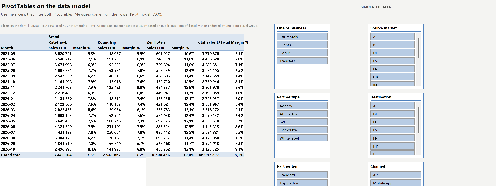

Real ECB reference rates by month, from the FX table of the model (the Turkish lira's fall drives incident E3):

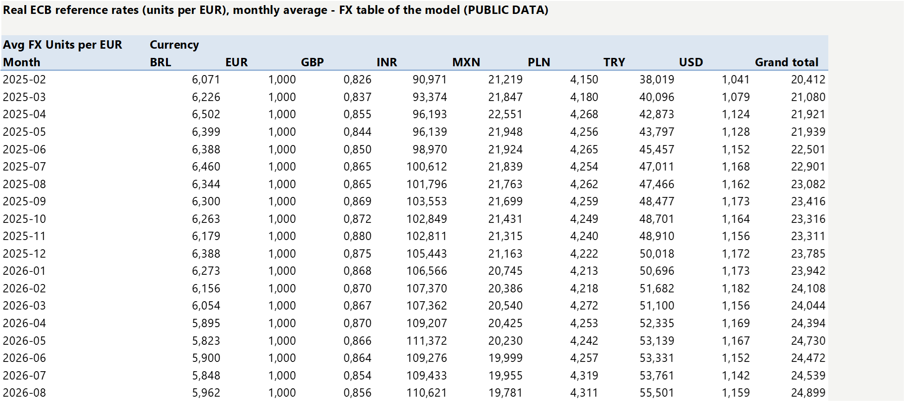

## 3. Alert band

Choose a dimension, a member and a metric. Expected = average of the same weekday over the previous 4 weeks; noise =
standard deviation of the daily deviation over the previous 56 days; alert when |z| ≥ 3.5. Shown: bookings from the
UAE, with the two alerts before the Eid al-Adha holiday (incident E4). Same rule as `sql/03_alerts_same_weekday.sql`.

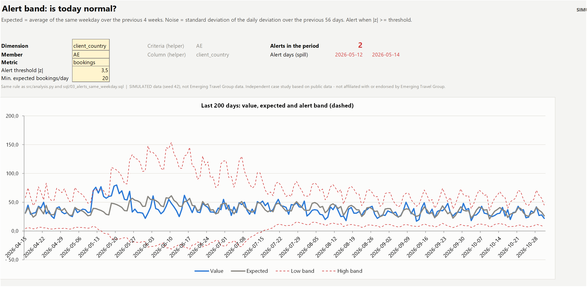

```excel
=LET(dimcol, INDEX(tblDaily, 0, MATCH($F$6, tblDaily[#Headers], 0)),
     SUMIFS(tblDaily[bookings], tblDaily[date], $B37, dimcol, $F$5))
```

## 4. Margin bridge: volume, mix, price, FX, cost

Pick two months. The margin change is split into five effects that add up exactly (check cell = 0). September 2025 →
September 2026: volume +€31k, mix −€1k, local prices +€55k, FX −€17k, supplier costs −€21k.

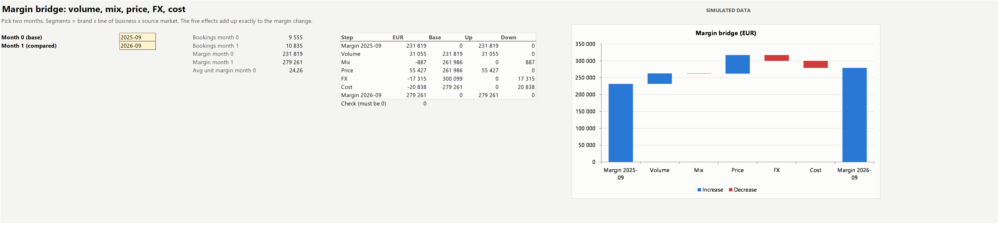

## 5. Price-match request calculator

Enter a partner's request: the sheet checks the evidence, makes the offers like-for-like (taxes, breakfast,
cancellation policy), computes the floor price (net cost / (1 − 4%)) and the maximum discount, then gives the
decision and writes the reply. Shown: a competitor rate that looks cheaper but is non-refundable, so the answer is a
reasoned refusal.

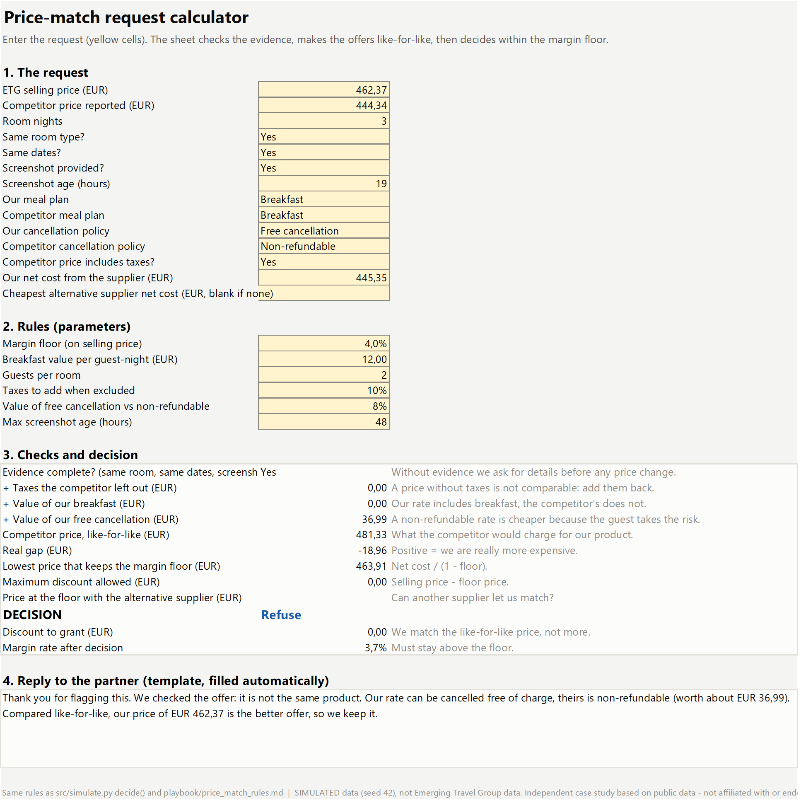

## 6. Price-match log and KPIs

1,347 requests: 21% discounted, 11% switched to a cheaper supplier, 51% refused with arguments, 17% asked for details.
A `LET` formula re-applies the rules to every row: 1,347 / 1,347 match the logged decision.

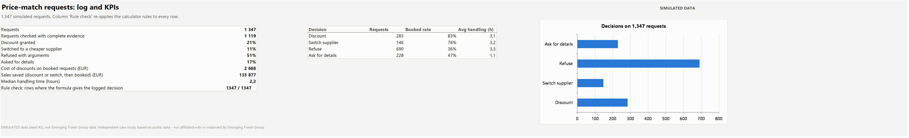

## 7. Pricing recommendations

Markup moves by B2B segment (±0.5 point), with the 90-day margin effect for an elasticity range you can change.

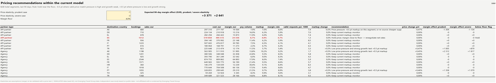

## 8. Data quality

The issues found in the raw ledger before any conclusion (duplicated load, missing supplier costs, time-zone shift) and
their effect on the daily totals.

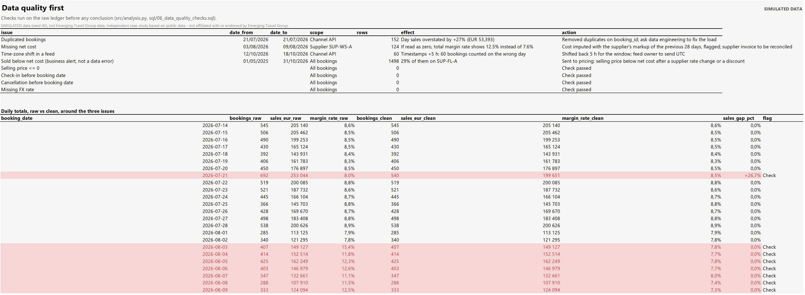
